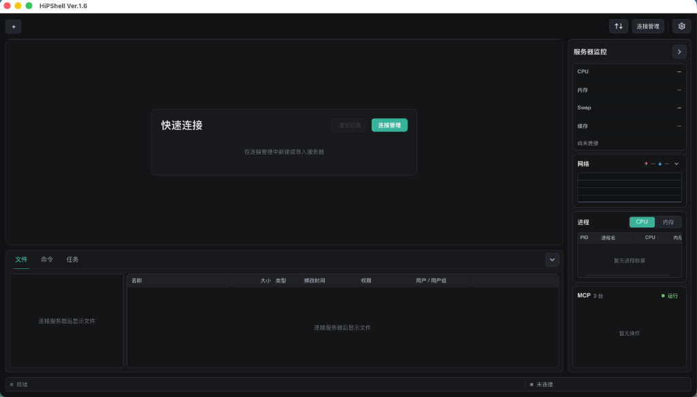

# HiPShell

[中文](README.zh-CN.md) | English

A lightweight SSH client for macOS and Windows built with Rust and Slint, with a built-in local MCP server.

Most AI + SSH tools open a separate background session that you cannot see. HiPShell lets an agent (Claude Code, Codex, etc.) work in the same terminal tab you already have open. You can watch every command it runs, step in at any time, and share whatever state is already in that shell (working directory, `sudo -i`, virtualenvs, tmux).



Note: most of the code in this repo was written with LLMs. Review it before relying on it and use it at your own risk.

## Working with AI

- The agent reads and writes directly in your open terminal tab, or runs non-interactive commands on a separate channel (`run_command`) without touching your prompt.
- Manual input takes priority. If you start typing, queued agent input stops; if you left a half-typed command on the line, the agent is instructed to ask before clearing it.
- When `sudo` or `su` asks for a password, HiPShell fills the connection's saved admin password directly (`input_admin_password`) so the password never passes through the LLM.
- MCP access is opt-in per connection. Unlisted servers stay hidden, and the agent cannot grant itself access, trust new host keys, or read stored credentials.
- The MCP server binds to `127.0.0.1` and only accepts local requests. Nothing needs to be installed on your remote hosts.

## Features

- Password, private key (OpenSSH, PEM, PuTTY `.ppk`), and keyboard-interactive auth; SOCKS5 / HTTP proxy; legacy algorithm support for older servers.
- Full VT terminal with vim, tmux, mouse support, Kitty keyboard protocol, and OSC 52 clipboard.
- SFTP file browser with drag-and-drop upload, resumable transfers, and a transfer queue.
- Linux resource monitor (CPU, memory, processes, network).
- Saved command groups, separate background command execution, and a task list.
- Import and export for FinalShell connection configs.
- Single portable binary, no external database.

## MCP setup

Start HiPShell, enable MCP on the connections you want to share (under Edit Connection), then add the local endpoint to your agent:

```json
{
  "mcpServers": {
    "hipshell": {
      "type": "http",
      "url": "http://127.0.0.1:7391/mcp"
    }
  }
}
```

For Claude Code:

```sh
claude mcp add --transport http --scope user hipshell http://127.0.0.1:7391/mcp
```

You can change the port or turn MCP off in **Settings → MCP**. To run without a window, use `hipssh --serve`.

Available tools:

| Group | Tools |
|---|---|
| Connection | `state`, `connect`, `reconnect`, `open_terminal`, `disconnect` |
| Terminal | `read_terminal`, `write_terminal`, `input_admin_password` |
| Command | `run_command` |
| Files | `list_files`, `list_local_files`, `upload_file`, `download_file` |
| Tasks | `get_task`, `cancel_task` |

## Build

Requires stable Rust.

```sh
cargo build --release          # binary at target/release/hipssh
sh run-macos.sh                # macOS: builds .dmg into dist/ and prepares windows-build/
```

On Windows, copy `windows-build/` to a machine with Visual Studio Build Tools ("Desktop development with C++") and run `build.bat`. See [packaging/windows/README.md](packaging/windows/README.md) for details.

## Data directory

- macOS: `~/Library/Application Support/HiPShell`
- Windows: `config\` next to `hipssh.exe`

Saved passwords use FinalShell-compatible encryption, which is reversible. Protect this directory accordingly.

## License

[MIT](LICENSE)

Icons from [Lucide](https://lucide.dev) (ISC). FinalShell password compatibility is based on [MeatShell](https://github.com/yituorou/meatshell) (MIT / Apache-2.0).
