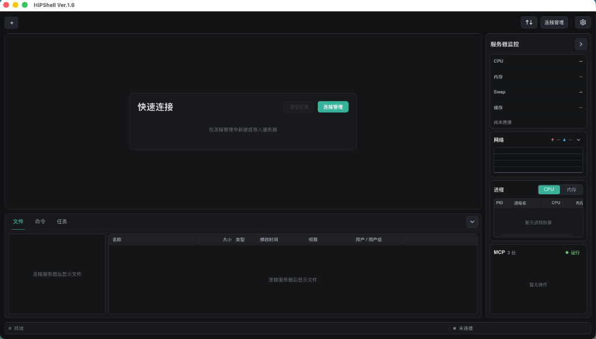

# HiPShell

中文 | [English](README.md)

用 Rust 和 Slint 写的轻量 SSH 客户端（支持 macOS 和 Windows），内置本地 MCP 服务。

大部分 AI + SSH 工具都是让模型在后台另开一条看不见的连接。HiPShell 让 AI（Claude Code、Codex 等）直接在你正在看的终端标签里操作：它执行的每条命令都实时可见，你之前敲过的内容它也看得到，随时可以自己接手。



说明：本项目大部分代码由 LLM 编写，可能存在问题，使用前请自行审查，风险自负。

## 与 AI 协作

- AI 直接读写你打开的终端标签，沿用当前目录、`sudo -i`、虚拟环境和 tmux；不想打扰终端时，也可以走独立通道执行非交互命令（`run_command`）。
- 人工操作优先：正在打字时会拒绝 AI 写入，已排队的输入在人工接管后也会停止发送；命令行里还有你敲了一半的内容时，AI 会先询问再清空。
- 终端出现 `sudo` 或 `su` 密码提示时，由 HiPShell 直接填入该连接保存的管理员密码（`input_admin_password`），密码不经过模型。
- 按连接单独开启 MCP 授权，未授权的服务器对 AI 不可见；AI 无法自行授权、信任新主机指纹或读取保存的凭据。
- MCP 服务只监听本机 `127.0.0.1` 且只接受本地请求，远端服务器不需要安装任何组件。

## 主要功能

- 支持密码、私钥（OpenSSH、PEM、PuTTY `.ppk`）和 keyboard-interactive 认证，支持 SOCKS5 / HTTP 代理，兼容老服务器加密算法。
- 完整的 VT 终端，支持 vim、tmux、鼠标、Kitty 键盘协议和 OSC 52 剪贴板。
- SFTP 文件管理、拖入上传、断点续传和传输进度队列。
- Linux 系统监控：CPU、内存、进程和网络流量。
- 常用命令分组、独立后台执行和任务列表。
- 支持导入和导出 FinalShell 连接配置。
- 单文件免安装，不依赖数据库。

## 接入 MCP

启动 HiPShell，在需要开放给 AI 的连接编辑页中开启 MCP 授权，然后在 AI 客户端里添加本地地址：

```json
{
  "mcpServers": {
    "hipshell": {
      "type": "http",
      "url": "http://127.0.0.1:7391/mcp"
    }
  }
}
```

Claude Code 可直接用命令行添加：

```sh
claude mcp add --transport http --scope user hipshell http://127.0.0.1:7391/mcp
```

端口和开关在 **设置 → MCP** 中调整。无界面运行使用 `hipssh --serve`。

内置工具列表：

| 类别 | 工具 |
|---|---|
| 连接 | `state`、`connect`、`reconnect`、`open_terminal`、`disconnect` |
| 终端 | `read_terminal`、`write_terminal`、`input_admin_password` |
| 执行 | `run_command` |
| 文件 | `list_files`、`list_local_files`、`upload_file`、`download_file` |
| 任务 | `get_task`、`cancel_task` |

## 从源码编译

需要 stable 版 Rust。

```sh
cargo build --release          # 产物位于 target/release/hipssh
sh run-macos.sh                # macOS：在 dist/ 生成 .dmg，并整理 windows-build/ 目录
```

Windows 下将 `windows-build/` 拷到装有 Visual Studio 生成工具（勾选“使用 C++ 的桌面开发”）的机器上，运行 `build.bat`。详细步骤见 [packaging/windows/README.md](packaging/windows/README.md)。

更新版本号时，修改 `Cargo.toml` 与 `packaging/macos/Info.plist`，再运行 `cargo update -p hipssh --offline` 同步 `Cargo.lock`。

## 数据位置

- macOS：`~/Library/Application Support/HiPShell`
- Windows：`hipssh.exe` 同级的 `config\` 目录

保存的密码采用与 FinalShell 兼容的加密方式，属于可逆加密，请妥善保管该目录。

## 许可

[MIT](LICENSE)

图标来自 [Lucide](https://lucide.dev)（ISC），FinalShell 密码兼容实现参考了 [MeatShell](https://github.com/yituorou/meatshell)（MIT / Apache-2.0）。
